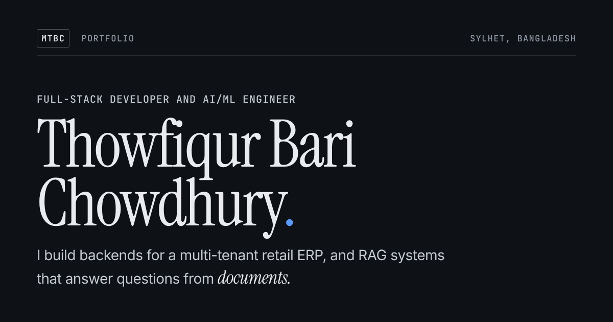

# Thowfiqur Bari Chowdhury — Portfolio

Personal portfolio of **Thowfiqur Bari Chowdhury (MTBC)** — Full-Stack Developer | AI/ML Engineer.
Production web apps with React, Next.js, NestJS, Express, FastAPI, PostgreSQL and MongoDB, plus RAG, agentic AI and machine-learning work.

**Live:** [thowfique041.github.io/Portfolio](https://thowfique041.github.io/Portfolio/) · hosted on GitHub Pages



## Design

An editorial, typography-led identity — no gradients, glow, glassmorphism or decorative 3D.

- **Type:** Instrument Serif for display (name, section titles, project names), Inter for text, JetBrains Mono for labels, and one Bengali accent (গবেষণা) in Hind Siliguri, loaded as a glyph subset. One type scale and an 8 px spacing scale throughout.
- **Colour:** dark theme in deep charcoal (`#0E1116`) with soft white text and a single electric-blue accent (`#5B9BFF`) used sparingly; a separately tuned light theme on warm paper (`#F4F1EA`) with deep charcoal text and a muted blue accent (`#2B5797`).
- **Layout:** asymmetric hero (large serif name, role, headline, and an at-a-glance “Now” list), a 3 / 9 column section grid with hairline rules, two written-up case studies, and a one-line list for the other projects.
- **Interaction:** live local time in Sylhet (GMT+6) for remote collaborators, an active-section underline in the navigation, a thin reading-progress line, quiet one-time reveals, and hover states on links, rows and cards — all disabled under `prefers-reduced-motion`.

## Functionality

- Dark / light theme toggle — saved in `localStorage`, follows the OS until the visitor chooses, applied before first paint (no flash).
- Mobile menu (Esc closes, focus moves into the menu), project filters (All / Full-stack / AI-ML), copy-email button, CV download, profile-photo slot.
- No third-party JavaScript and no build step. Works offline / without the font CDN (system fallbacks) and with JavaScript disabled.
- Semantic landmarks, one `h1`, ordered headings, skip link, visible focus, AA contrast in both themes, ≥ 44 px touch targets.
- SEO: title, description, canonical, Open Graph + Twitter card (`assets/og-image.png`), JSON-LD `Person`, SVG favicon + Apple touch icon.

## Project structure

```text
Portfolio/
├── index.html                 # all content and markup
├── style.css                  # tokens (dark + light), type & spacing scales, layout, components
├── script.js                  # theme, navigation, filters, clock, reveals
├── favicon.svg
├── images.png                 # previous avatar (no longer used on the page)
├── assets/
│   ├── og-image.png           # social preview 1200×630
│   ├── apple-touch-icon.png
│   └── screenshots/           # project screenshots (placeholders for now)
└── public/
    └── Thowfiqur_CV.pdf       # served by every "Download CV" button
```

All paths are relative, so the site works under the GitHub Pages sub-path `/Portfolio/`.

## Customising

- **Profile photo:** add `assets/me.jpg` (portrait, about 800×1000) and set `data-photo="assets/me.jpg"` on the `.hero-photo` element in `index.html`. It appears above the “Now” list; the slot stays hidden until then.
- **Project screenshots:** replace `assets/screenshots/halkabite.png` and `assets/screenshots/nexusrag.png` (currently labelled placeholders) with real screenshots, then update each image’s `alt` text. Paths are relative on purpose: a leading `/` would break under the `/Portfolio/` sub-path.
- **TODOs:** search `index.html` for `TODO`. Visible TODO boxes are styled with an orange dashed border so they can’t be missed before deploying.
- **CV:** replace `public/Thowfiqur_CV.pdf` (keep the file name).
- **Colours & type:** edit the tokens at the top of `style.css`.

## Run locally

```bash
git clone https://github.com/thowfique041/Portfolio.git
cd Portfolio
python3 -m http.server 8000
```

Open <http://localhost:8000>.

## Deploy (GitHub Pages)

The site deploys from the `main` branch root.

```bash
git checkout main
git merge identity          # or open a pull request from `identity` and merge it on GitHub
git push origin main
```

Then check **Settings → Pages**: *Source: Deploy from a branch*, *Branch: `main` / `(root)`*. The new version is live within a few minutes; use a hard refresh (`Ctrl + Shift + R`) if the old one is cached.

## Connect

- Email: [thowfiqurbarrychowdhury@gmail.com](mailto:thowfiqurbarrychowdhury@gmail.com)
- GitHub: [github.com/thowfique041](https://github.com/thowfique041)
- LinkedIn: [thowfiqur-bary-chowdhury](https://www.linkedin.com/in/thowfiqur-bary-chowdhury-06b75b339/)
- Kaggle: [kaggle.com/thowfiq041](https://www.kaggle.com/thowfiq041)

## License

Not specified.
